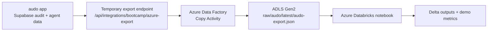

# Audo Bootcamp Azure + Databricks Runbook

This is a temporary demo integration for the startup AI bootcamp. It keeps the product stack unchanged and adds one read-only export endpoint that Azure Data Factory can copy into Azure Data Lake Storage Gen2. Databricks then reads that file, writes Delta outputs, and shows demo metrics.

## What You Are Building



## 1. Add Environment Variables

Add these wherever the demo app runs, usually Vercel Project Settings -> Environment Variables, and locally in `.env.local` if testing from localhost.

```bash
BOOTCAMP_EXPORT_TOKEN="make-a-long-random-token"
SUPABASE_SERVICE_ROLE_KEY="your-supabase-service-role-key"
```

The export route already uses `NEXT_PUBLIC_SUPABASE_URL`, which the app should already have.

Test it locally:

```powershell
curl.exe -H "x-audo-export-token: make-a-long-random-token" "http://localhost:3000/api/integrations/bootcamp/azure-export?limit=10"
```

Production URL:

```powershell
curl.exe -H "x-audo-export-token: make-a-long-random-token" "https://useaudo.com/api/integrations/bootcamp/azure-export?limit=10"
```

Use `?format=ndjson` only if you want newline-delimited records. The Databricks notebook expects the default JSON envelope.

## 2. Create Azure Resources

Use one resource group so cleanup is easy after demo day.

1. Azure Portal -> Resource groups -> Create.
2. Name: `rg-audo-bootcamp-demo`.
3. Region: pick the closest available region, for example `East US` or `West US 2`.

Create Data Lake Storage:

1. Create a Storage Account.
2. Name: globally unique, for example `audobootcamp<random>`.
3. Performance: Standard.
4. Redundancy: LRS is fine for demo.
5. Advanced -> Enable hierarchical namespace. This makes it ADLS Gen2.
6. Create a container named `audo-demo`.
7. Create folders:
   - `raw/audo/latest`
   - `delta/audo`

Create Azure Data Factory:

1. Create Data Factory.
2. Name: `adf-audo-bootcamp`.
3. Put it in the same resource group.
4. Open Azure Data Factory Studio.

Create Azure Databricks:

1. Create Azure Databricks workspace.
2. Name: `dbx-audo-bootcamp`.
3. Pricing tier: Premium if available, Standard is fine for a short demo.
4. Open the workspace.
5. Create compute or use serverless if your workspace supports it.
6. Import `databricks/audo_bootcamp_pipeline.py` as a notebook.

## 3. Data Factory Pipeline

Create linked services:

1. Manage -> Linked services -> New.
2. Add REST linked service:
   - Base URL: `https://useaudo.com`
   - Authentication: Anonymous
3. Add Azure Data Lake Storage Gen2 linked service:
   - Use account key or managed identity.
   - Point it at the storage account.
4. Add Azure Databricks linked service:
   - Point it at the Databricks workspace.
   - Use a personal access token for the fastest demo setup.

Create datasets:

1. REST dataset:
   - Relative URL: `/api/integrations/bootcamp/azure-export?limit=50`
   - Request method: GET
   - Additional header: `x-audo-export-token: <BOOTCAMP_EXPORT_TOKEN>`
2. ADLS JSON dataset:
   - Container: `audo-demo`
   - File path: `raw/audo/latest/audo-export.json`

Create pipeline:

1. Add Copy Data activity: `copy_audo_export_to_lake`.
2. Source: REST dataset.
3. Sink: ADLS JSON dataset.
4. Add Azure Databricks Notebook activity: `run_audo_delta_pipeline`.
5. Notebook path: the imported `audo_bootcamp_pipeline`.
6. Base parameters:

```text
raw_path = abfss://audo-demo@<storage-account-name>.dfs.core.windows.net/raw/audo/latest/audo-export.json
output_path = abfss://audo-demo@<storage-account-name>.dfs.core.windows.net/delta/audo
```

Connect Copy activity success -> Databricks notebook activity.

## 4. Databricks Storage Access

Fastest demo path:

1. In the Databricks notebook, set Spark config for the storage account key before reading:

```python
spark.conf.set(
  "fs.azure.account.key.<storage-account-name>.dfs.core.windows.net",
  "<storage-account-access-key>"
)
```

More production-like path:

1. Create an Azure service principal.
2. Grant it Storage Blob Data Contributor on the storage account or container.
3. Configure OAuth in Databricks Spark configs.

For demo day, account key is fastest. Remove it after the event.

## 5. Demo Script

1. Start with the audo dashboard and run a live agent audit.
2. Show the live browser stream and timeline.
3. Open Azure Data Factory and click Trigger now on the pipeline.
4. Show Copy Data moving audit data into ADLS.
5. Open Databricks notebook output:
   - audit count
   - agent event count
   - open checklist items
   - demo readiness score
   - event type distribution
6. Say: “audo’s product stays simple for founders, but the audit telemetry is now enterprise-ready: orchestrated by Azure Data Factory, stored in Data Lake, and transformed in Databricks for intelligence and reporting.”

## 6. Fallbacks

If Data Factory is slow:

1. Run the export endpoint with curl.
2. Save the JSON as `audo-export.json`.
3. Upload it manually to `raw/audo/latest/audo-export.json` in the storage container.
4. Run the Databricks notebook directly.

If Databricks storage auth fights you:

1. Upload `audo-export.json` to `dbfs:/FileStore/audo_bootcamp/audo-export.json`.
2. Run the notebook with default widget values.

If live agent fails during the presentation:

1. Use the live agent demo/replay fallback in audo.
2. Trigger ADF using previous audit data.
3. Show Databricks metrics from the last successful export.

## 7. Cleanup After Demo Day

To remove the temporary integration:

1. Delete `app/api/integrations/bootcamp/azure-export/route.ts`.
2. Delete `databricks/audo_bootcamp_pipeline.py`.
3. Delete this runbook.
4. Remove `BOOTCAMP_EXPORT_TOKEN` from Vercel/local env.
5. Delete Azure resource group `rg-audo-bootcamp-demo`.

## Official Setup References

- Azure Data Lake Storage Gen2 connector for Data Factory: https://learn.microsoft.com/en-us/azure/data-factory/connector-azure-data-lake-storage
- Azure Data Factory REST connector: https://learn.microsoft.com/en-us/azure/data-factory/connector-rest
- Azure Data Factory Databricks notebook activity: https://learn.microsoft.com/en-us/azure/data-factory/transform-data-using-databricks-notebook
- Azure Databricks workspace creation: https://learn.microsoft.com/en-us/azure/databricks/admin/workspace/
- Azure Databricks with ADLS Gen2 tutorial: https://learn.microsoft.com/en-us/azure/storage/blobs/data-lake-storage-use-databricks-spark
